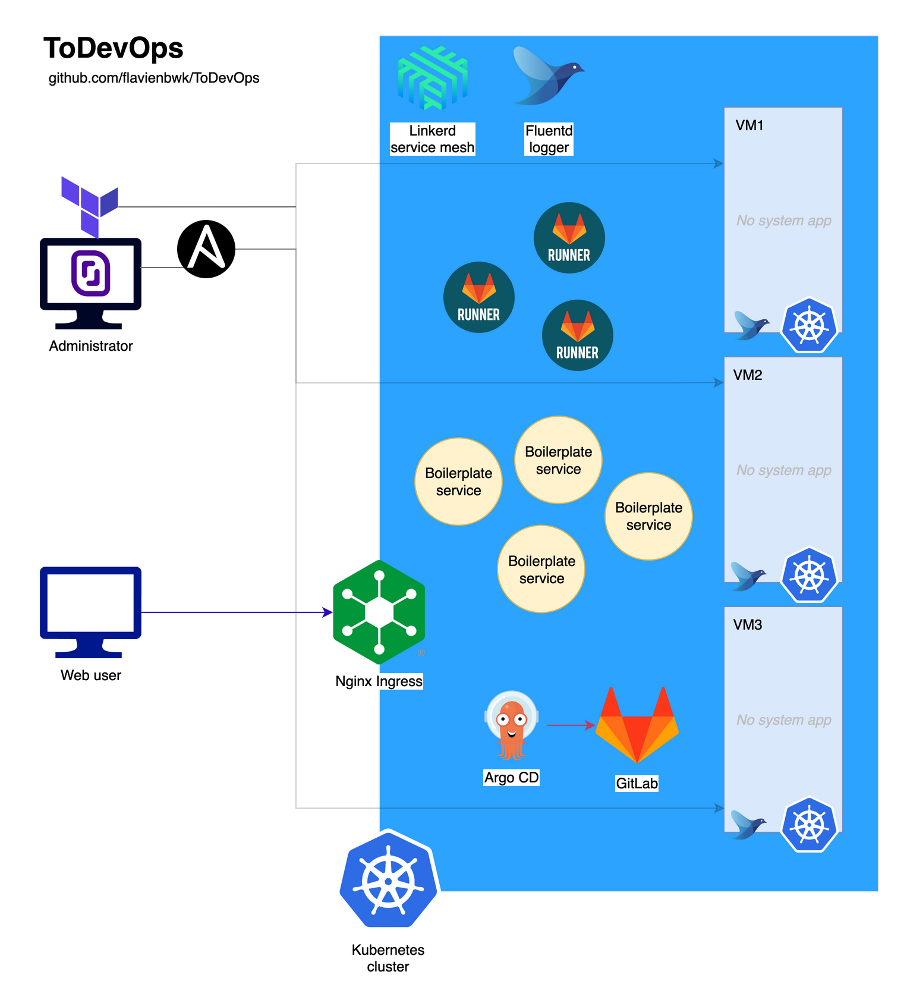

<p align="center">
  
</p>

<h1 align="center">ToDevOps</h1>

<p align="center">
  <strong>A bare-metal Kubernetes platform on Scaleway, from three empty VMs to a GitOps deployment.</strong><br>
  Terraform creates the machines, Ansible turns them into a kubeadm cluster with Ingress, Linkerd,
  EFK logging, GitLab and Argo CD, and a sample repository gets deployed continuously.
</p>

<p align="center">
  <a href="#quick-start">Quick start</a> &middot;
  <a href="#how-it-works">How it works</a> &middot;
  <a href="#playbooks">Playbooks</a> &middot;
  <a href="#tech-stack">Tech stack</a> &middot;
  <a href="#documentation">Documentation</a> &middot;
  <a href="#credits">Credits</a>
</p>

<p align="center">
  
  
  
  
  
  
</p>

<p align="center">
  
  <br>
  <sub>Three Scaleway VMs, one Kubernetes cluster. Web users enter through the Nginx Ingress;
  Argo CD pulls the application from the GitLab hosted in the same cluster.</sub>
</p>

---

Learning the modern DevOps stack means wiring a dozen tools together, and most tutorials stop
after one of them. **ToDevOps** builds the whole chain at once: Terraform instantiates three
Ubuntu VMs on Scaleway, Ansible installs Docker, kubeadm and Helm, initialises a control plane
with Flannel, joins the two nodes, then layers the services on top. Nginx Ingress with MetalLB
and a HAProxy front on the master expose everything under `*.todevops.local` with a self-signed
wildcard certificate; Linkerd meshes the traffic; Fluentd ships container logs to Elasticsearch
and Kibana; GitLab (with runners and a registry) and Argo CD close the loop by deploying a
repository imported into GitLab.

This repository is a **fork of [flavienbwk/ToDevOps](https://github.com/flavienbwk/ToDevOps)**,
written in 2022 while we were both at ETNA. Clément contributed the Ingress configuration
(ingress-nginx, MetalLB, HAProxy, TLS), the Linkerd 2.12 upgrade, the Fluentd logging stack and
the Argo CD repository setup. Upstream calls the project alpha, for testing only, and so does
this fork. The roles are idempotent: re-run them until the expected state is reached.

## Quick start

**Prerequisites:** [Terraform](https://www.terraform.io/downloads) 0.13 or later,
[Ansible](https://docs.ansible.com/ansible/latest/installation_guide/intro_installation.html),
`jq`, a Scaleway project with an API key, and an SSH key accepted as `root` on the instances.
Three VMs with 8 GB of RAM are the minimum.

```bash
git clone https://github.com/verovec/ToDevOps.git && cd ToDevOps
export TF_VAR_SCW_PROJECT_ID="my-project-id" TF_VAR_SCW_ACCESS_KEY="my-access-key" TF_VAR_SCW_SECRET_KEY="my-secret-key"
(cd plans && terraform init && terraform apply && terraform output -json > terraform_values.json)
bash terraform_to_ansible_values.sh                      # writes the public IPs into inventories/scaleway.ini
ansible-playbook -i inventories/scaleway.ini set_local_hosts.yml --extra-vars @vars/scaleway.yml --ask-become-pass   # *.todevops.local in your /etc/hosts
for t in base k8s-setup k8s-gitlab k8s-linkerd k8s-logging k8s-argocd; do
  ansible-playbook -i inventories/scaleway.ini playbooks/infrastructure.yml -t $t --extra-vars @vars/scaleway.yml
done
ansible-playbook -i inventories/scaleway.ini playbooks/setup-continuous-deployment.yml -t import-repository --extra-vars @vars/scaleway.yml --extra-vars "gitlab_password={{ gitlab_root_password }}"
ansible-playbook -i inventories/scaleway.ini playbooks/setup-continuous-deployment.yml -t configure-argocd-repository --extra-vars @vars/scaleway.yml --extra-vars "gitlab_user=root"
```

Then open `https://gitlab.todevops.local` (root / `mySuperSecurePassword`),
`http://linkerd.todevops.local` (admin / admin), `http://kibana.todevops.local` and
`https://argocd.todevops.local` (admin / `mySuperSecurePassword`). The passwords are in
`vars/scaleway.yml`. The full walkthrough with the explanation of each step is in
[`docs/deployment.md`](docs/deployment.md).

## How it works

```
  Terraform     plans/scaleway.tf: three DEV1-L Ubuntu Jammy instances with public IPs (fr-par-1)
     |
  Inventory     terraform_to_ansible_values.sh copies the IPs into inventories/scaleway.ini
     |
  base          /etc/hosts entries, Docker 19.03, kubectl 1.22, Helm 3, insecure registry setting
     |
  k8s-setup     kubeadm init on master, Flannel, ingress-nginx, MetalLB, OpenEBS, dashboard, metrics,
                wildcard certificate, HAProxy on 80/443 to the ingress NodePorts; nodes join
     |
  k8s-gitlab    GitLab CE chart 6.2.2 on OpenEBS hostpath, runners, registry login and regcred secret
     |
  k8s-linkerd   Linkerd 2.12.0 CLI, control plane, linkerd-viz behind a basic-auth ingress
     |
  k8s-logging   kube-logging chart: Elasticsearch, Fluentd DaemonSet, Kibana ingress
     |
  k8s-argocd    Argo CD 2.4.8 with an SSL passthrough ingress and a patched admin password
     |
  CD            SSH key and project created in GitLab, Nginx-Template-Deployment pushed there,
                Argo CD Application watching its manifests/ with automated sync
```

Every service is exposed through the ingress for convenience. For anything beyond a test
cluster delete those ingresses and use `kubectl port-forward` instead (see
[`docs/deployment.md`](docs/deployment.md), step 2.5).

## Playbooks

| Playbook and tag | Roles | Result |
|------------------|-------|--------|
| `set_local_hosts.yml` | `setup_domain_names` on localhost | `*.todevops.local` resolve to the master on your machine |
| `infrastructure.yml -t base` | `setup_domain_names`, `install_kubernetes_utils` | Docker, kubectl, Helm and hosts entries on the three VMs |
| `infrastructure.yml -t k8s-setup` | `setup_kubernetes_cp`, `setup_kubernetes_node` | The cluster, its network, ingress, storage and the HAProxy front |
| `infrastructure.yml -t k8s-gitlab` | `deploy_gitlab`, `bind_docker_registry` | GitLab CE, admin users, registry credentials in the cluster |
| `infrastructure.yml -t k8s-linkerd` | `install_kubernetes_linkerd` | Service mesh and its dashboard |
| `infrastructure.yml -t k8s-logging` | `install_kubernetes_logging` | Elasticsearch, Fluentd, Kibana |
| `infrastructure.yml -t k8s-argocd` | `install_kubernetes_argocd` | Argo CD and its ingress |
| `setup-continuous-deployment.yml -t import-repository` | `setup_gitlab_ssh_key`, `setup_gitlab_repository` | The sample repository pushed into GitLab |
| `setup-continuous-deployment.yml -t configure-argocd-repository` | `configure_argocd_repository` | Argo CD deploys it into the `my-app` namespace |

## Tech stack

| Layer | Tech | Location |
|-------|------|----------|
| Instances | Terraform, Scaleway provider 2.2.7, three DEV1-L servers | `plans/scaleway.tf` |
| Configuration | Ansible roles, static INI inventory, shared variables | `roles/`, `inventories/scaleway.ini`, `vars/scaleway.yml` |
| Cluster | kubeadm 1.22.11, Flannel, Docker 19.03, Helm 3 | `roles/setup_kubernetes_cp`, `roles/setup_kubernetes_node`, `roles/install_kubernetes_utils` |
| Ingress and storage | ingress-nginx 1.3.0, MetalLB, HAProxy, OpenEBS, self-signed wildcard cert | `roles/setup_kubernetes_cp/files/` |
| Source and CI | GitLab CE chart 6.2.2 with runners and registry | `roles/deploy_gitlab`, `roles/bind_docker_registry` |
| Mesh, logs | Linkerd 2.12.0 and linkerd-viz; Elasticsearch, Fluentd, Kibana chart | `roles/install_kubernetes_linkerd`, `roles/install_kubernetes_logging/files/charts/kube-logging` |
| Delivery | Argo CD 2.4.8, Application on `manifests/` of the imported repository | `roles/install_kubernetes_argocd`, `roles/configure_argocd_repository` |

Details in [Architecture](docs/architecture.md).

## Documentation

| Topic | Where |
|-------|-------|
| VMs, roles, cluster services, network path, variables | [`docs/architecture.md`](docs/architecture.md) |
| Step-by-step deployment and the credentials of each UI | [`docs/deployment.md`](docs/deployment.md) |
| Re-running roles, reaching the cluster, teardown | [`docs/development.md`](docs/development.md) |
| Everything else | [`docs/`](docs/README.md) |

## Contributing

The fork is kept in the state of September 2022 and is not maintained. Issues are still welcome
here, and improvements to the stack belong upstream: open
[a suggestion](https://github.com/flavienbwk/ToDevOps/issues/new?assignees=&labels=&template=suggestion-or-feedback.md&title=%5BSUGGESTION%5D+)
on Flavien's repository, which stays the reference.

## Credits

- [Flavien Berwick (flavienbwk)](https://github.com/flavienbwk) wrote the original
  [ToDevOps](https://github.com/flavienbwk/ToDevOps): the Terraform plan, the cluster, GitLab,
  OpenEBS, Argo CD and the documentation this fork is based on. If it helped you, consider
  [sponsoring him](https://github.com/sponsors/flavienbwk) or
  [suggesting improvements](https://github.com/flavienbwk/ToDevOps/issues/new?assignees=&labels=&template=suggestion-or-feedback.md&title=%5BSUGGESTION%5D+).
- [Clément Verove (verovec)](https://github.com/verovec): Ingress, Linkerd and Fluentd
  configurations, Argo CD repository setup.
- The sample application upstream deploys is the
  [reactjs-flask-ldap-boilerplate](https://github.com/flavienbwk/reactjs-flask-ldap-boilerplate);
  this fork points Argo CD at [Nginx-Template-Deployment](https://github.com/verovec/Nginx-Template-Deployment).

More resources for a career in DevOps, as listed upstream:
[Google SRE books](https://sre.google/books),
[Building Secure and Reliable Systems](https://www.google.com/books/edition/Building_Secure_and_Reliable_Systems/Kn7UxwEACAAJ),
[SRE and DevOps Engineer with Google Cloud](https://www.coursera.org/professional-certificates/sre-devops-engineer-google-cloud),
[Google Cloud Skills Boost quest](https://www.cloudskillsboost.google/quests/141?locale=fr),
DoD's [Platform One](https://software.af.mil/team/platformone/).
